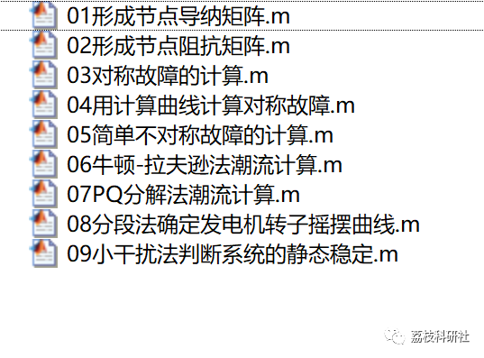
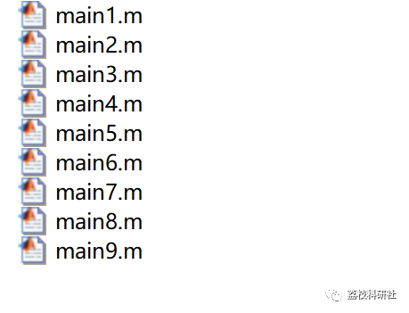

# Power System Analysis (Matlab Code Implementation)

💥💥💥💞💞💞 Welcome to this blog❤️❤️❤️ 💥💥💥
🏆 Bloggers' Advantage: 🌞🌞🌞 The content of the blog strives for thoughtfulness and clarity, making it convenient for readers.
⛳️ Mantra: "Those who travel a hundred miles may find half of it is still remaining."
Litchi Research Society
Code Collection: Power Systems, Intelligent Algorithms and Applications, Neural Network Prediction, Path Planning, Optimized Scheduling, Workshop Scheduling, Image Processing, Signal Processing...
🎁 Special Section Link: ​
🌈🌈🌈🌟🌟🌟 Electrical Code Drone and Physical Applications Path Planning Intelligent Algorithms and Their Applications Optimized Scheduling Neural Network Prediction Workshop Scheduling Image Processing Romantic Her Signal Processing Mathematical Modelling My Philosophical Thoughts Speech Processing Complete Code Issues
💥1 Overview
Rename accordingly.
📚2 Example 9
09 Small disturbance method to judge system's static stability
🎉3 Complete MATLAB Code
Click the article's lower left corner to read more.

## Images

<!-- PAYMENT_BLOCK -->

## Get this dataset

- Payment link (Stripe): [Buy now](https://buy.stripe.com/3cs8yP7sY87d0vu9AB)
- Payment QR code: 

<!-- /PAYMENT_BLOCK -->
